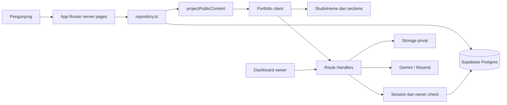

# Arsitektur — PramudyaSpaces

Snapshot implementasi 23 Oktober 2026. Perubahan diusulkan ditandai sebagai aturan/target; struktur yang disebut berikut memang tersedia di repositori.

## Bentuk aplikasi

Satu aplikasi Next.js App Router dengan halaman publik, dashboard owner, dan Route Handlers. TypeScript strict digunakan. Supabase menyediakan Auth, Postgres, dan Storage privat. Gemini melayani chat/terjemahan; Resend bersifat opsional untuk notifikasi kontak.

Diagram ini menyederhanakan jalur request; akses publik tertentu memakai service client setelah kebijakan aplikasi diperiksa. Jangan menyimpulkan semua akses database dilindungi RLS ketika memakai secret key.

## Peta modul dan tanggung jawab

| Lokasi | Pemilik tanggung jawab |
|---|---|
| `src/app/page.tsx` | Data awal dan metadata home; route dinamis |
| `src/app/projects/page.tsx`, `src/app/projects/[id]/page.tsx` | Archive/detail proyek |
| `src/app/loading.tsx`, `error.tsx`, `not-found.tsx` | Fallback route |
| `src/app/sitemap.ts`, `robots.ts`, `src/lib/seo.ts` | Sitemap proyek publik, kebijakan crawler dan metadata/canonical produksi |
| `src/app/admin/(dashboard)/layout.tsx` | Gate sesi dan owner sebelum dashboard |
| `src/app/api/` | Boundary HTTP: auth, validasi, kebijakan, efek samping, respons |
| `src/proxy.ts` | Refresh sesi Supabase pada admin/auth/API; bukan pengganti owner check |
| `src/components/portfolio.tsx` | Preferensi, initial loading, navigasi aktif, pemilihan halaman/panel |
| `src/components/studio-home.tsx` | Komposisi section home dan data tampilan |
| `src/components/sections/` | Satu file per section; interaksi khusus tetap terlokalisasi |
| `src/components/layout/` | Header/footer dan kontrak props bersama |
| `src/components/projects/` | Archive, galeri, cover, detail, bukti karya |
| `src/components/admin/` | Pengisian CMS dan workflow owner |
| `src/components/ui/` | Komponen presentasi bersama |
| `src/lib/model.ts`, `validation.ts` | Tipe domain dan validasi runtime |
| `src/lib/repository.ts`, `supabase.ts` | Akses data/koneksi/sesi server |
| `src/lib/content.ts` | Proyeksi publik, fingerprint, transformasi terjemahan/media publik |
| `src/lib/project-relations.ts`, `studio-content.ts` | Relasi, pemilahan dan derived data |
| `src/lib/http.ts`, `http-error.ts`, `origin-policy.ts` | Wrapper HTTP, error publik bertipe/tersanitasi, origin, rate limit |
| `src/lib/translation.ts`, `ai.ts` | Integrasi AI dan cache terjemahan |
| `supabase/migrations/` | Schema, policies, RPC dan evolusi database |
| `tests/`, `scripts/` | Tes otomatis dan alat operasional; klasifikasi di TESTING |

## Batas server dan client

Halaman mengambil `getPublicContent()` di server sebelum menyerahkan `PublicContent` ke `Portfolio`. `getContent()` adalah data lengkap untuk operasi server/admin; **jangan** memasukkannya ke props browser publik.

Saat ini `Portfolio` dan komposisi `StudioHome` berada di boundary client; tidak seluruh section merupakan Server Component. Target perubahan baru: pertahankan bagian noninteraktif di server jika praktis, perkecil boundary client secara bertahap berdasarkan pengukuran. Jangan memindahkan semuanya sekaligus hanya demi pola.

Modul Supabase, repository, HTTP, dan integrasi provider server memakai `server-only` bila relevan. Komponen presentasi menerima props; jangan mengimpor service client ke section. Aturan Next.js mengenai boundary dan data dibahas pada [Server/Client Components](https://nextjs.org/docs/app/getting-started/server-and-client-components) dan [Data Security](https://nextjs.org/docs/app/guides/data-security).

## Model data dan invarian

| Entitas/tabel | Makna |
|---|---|
| `owners` | Membership owner tunggal; constraint singleton |
| `profile` | Identitas, foto formal/hero, kontak/izin, copy section, data karier privat |
| `entries` | Koleksi bertipe `kind`, judul, JSON data, posisi, status publikasi |
| `documents` | Metadata PDF, format, path dan publikasi |
| `media` | Metadata aset; file pada bucket `portfolio` privat |
| `inbox` | Pesan kontak privat |
| `guestbook` | Pesan publik yang dapat disembunyikan, balasan admin |
| `translations` | Terjemahan otomatis/koreksi dan versi sumber |
| `request_limits` | Counter atomik pembatasan request |

`Entry.data` memakai record fleksibel; tipe TypeScript saja tidak cukup untuk membuktikan payload aman. Zod memvalidasi input; allowlist di `projectPublicContent()` membatasi output publik. `published` dan `show_email/show_phone` adalah aturan data, bukan sekadar CSS.

Relasi proyek berada di `related_project_ids`, bukan foreign key JSON yang otomatis menjamin referensi valid. Projection menghapus target tidak terbit/tidak tersedia. Pemilihan manual kosong berarti tanpa relasi; fallback otomatis hanya mengikuti perilaku helper pada jenis konten yang mendukungnya.

## Alur request penting

- **Publik:** repository → projection → props publik → selector `studioContent` → section. Draft dan data privat tidak boleh bergantung pada penyembunyian client.
- **Admin:** request → `api()`/origin → `requireOwner()` → Zod → session client/RPC → hasil. Route dengan efek khusus harus tetap menguji izin di server.
- **Media:** validasi path → cek daftar referensi publik; jika tidak publik cek owner → download Storage → respons. Saat ini `private, no-store`; mengubah cache membutuhkan strategi pencabutan akses.
- **Kontak:** validasi/honeypot → rate limit → simpan Inbox → notifikasi opsional → sukses. Retry email tidak boleh memicu pengiriman kontak ganda.
- **Guestbook:** GET terhalaman untuk pesan nonhidden; POST memerlukan owner atau identitas sosial yang diterima, dengan rate limit.
- **Terjemahan:** sumber sudah publik → fingerprint/cache/koreksi → hasil Inggris atau fallback sumber. Perubahan sumber tidak boleh merusak koreksi section lain.
- **Chat:** validasi/history terbatas → pembatasan sesi/pengunjung/global → data publik → provider → jawaban atau kegagalan terkontrol.

## Loading, lifecycle dan render

Fallback server dimiliki `app/loading.tsx`. Loader client menunggu preferensi, data awal/bahasa, `document.fonts.ready` dan decode gambar yang berada di viewport. Semua gambar offscreen tidak ditunggu. Error aset memakai fallback, pengguna dapat skip, dan timeout otomatis 8 detik mencegah deadlock. Exit 600ms, fallback pelepasan 700ms; reduced motion atau preferensi motion off keluar tanpa animasi. Loader dan root portofolio menerima keputusan gerak yang sama.

Saat exit, halaman mulai terlihat di balik loader tetapi tetap inert dan scroll terkunci sampai exit selesai. Effect harus membersihkan observer/listener/frame/timer/fetch yang sudah tidak relevan. Loading ini tidak menjamin data semua panel, respons provider, dan semua aset selesai dimuat.

Foto reveal memakai canvas 2D, lingkungan sinematik memakai WebGL ringan. `cinematic-scene.ts` membatasi kualitas; touch/reduced motion/perangkat lemah memakai fallback. Scroll native; tidak ada scroll hijacking atau kebutuhan Three.js.

## Aturan evolusi arsitektur

- Dependency mengarah dari UI ke kontrak/helper, dari boundary server ke kebijakan dan akses data. Jangan membuat domain mengimpor komponen React.
- Pisahkan keputusan domain dari I/O agar dapat diuji. Jika variasi provider benar-benar dibutuhkan, gunakan interface kecil di seam; tidak perlu DI container/base repository universal.
- Field CMS baru harus ditelusuri melalui model, schema, editor, persistensi, projection, translation/media permissions jika relevan, rendering, dan tes.
- Migrasi baru bersifat terurut dan mempertahankan data. Periksa target/history; jangan mengedit migrasi yang sudah diterapkan sebagai cara memperbaiki remote.
- Saat ini CSS global/scoped masih bertumpuk, route tertentu masih memuat data penuh, dan boundary client masih lebar. Ini utang yang harus diukur sebelum refactor, bukan alasan menulis ulang aplikasi.

Batas keamanan: [SECURITY](SECURITY.md). Konvensi implementasi: [CODE_STYLE](CODE_STYLE.md). Bukti pemeriksaan: [TESTING](TESTING.md).

## Penemuan halaman publik

Sitemap dinamis membaca projection publik yang sama dengan halaman proyek, sehingga URL draft tidak dimasukkan. Canonical/OG beranda, archive dan detail memakai origin produksi tetap di `seo.ts`, bukan `SITE_URL` auth yang dapat menunjuk localhost. Section anchor bukan route mandiri. File verifikasi GSC di public harus dipertahankan utuh; matcher proxy tetap hanya admin/auth/API. Tidak ada perubahan izin data atau UI untuk SEO.
